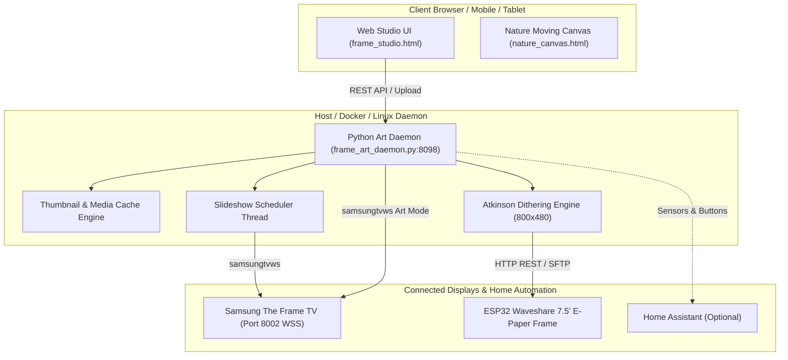

# 🖼️ Samsung The Frame • Art Studio & Custom Galleries

[](https://opensource.org/licenses/MIT)
[](https://www.python.org/downloads/)
[](#)
[](Dockerfile)

> A modern, self-hosted web studio, uploader, automated slideshow scheduler, and ambient display engine for **Samsung The Frame TVs (2017–2026+)** and optional **ESP32 Waveshare 7.5" E-Paper picture frames**.

---

## ✨ Features

- **🖼️ Native Samsung The Frame Art Mode Integration**
  - Direct WebSocket communication using [`samsungtvws`](https://github.com/NickWaterton/samsung-tv-ws-api).
  - Upload 4K UHD images directly to the TV's internal art memory with 1 tap.
  - Set custom virtual mattes: Modern Warm White, Polar White, Shadowbox, Neutral, or Full Bleed (None).
- **🎨 Interactive Web Studio (`frame_studio.html`)**
  - Luxury gold & dark glass interface.
  - Automatic 16:9 (3840×2160) canvas crop & aspect ratio lock.
  - Drag-and-drop batch upload directly from your browser.
  - Built-in color grading, contrast enhancement, and vintage filters.
- **🏛️ 1-Click Museum Curation Presets**
  - Instant high-resolution ingestion via the Art Institute of Chicago IIIF API (Monet, Seurat, Bierstadt, Cole, etc.).
  - 1-click **Bing 4K Daily Wallpaper** fetch and TV display.
- **⏱️ Smart Automated Slideshow Scheduler**
  - Background daemon thread rotates art on your TV at configurable intervals (e.g. every 15, 30, or 60 minutes).
  - Random or sequential rotation.
  - Filter rotation by folder or custom curated playlists.
- **🧹 Full Tidy-Up & Garbage Collection**
  - Removing an artwork cleanly deletes the file, removes the cached thumbnail, prunes empty directories, updates all playlists, and **purges the Content ID from Samsung TV storage**.
- **📟 Waveshare 7.5" ESP32 E-Paper Display Engine (800×480)**
  - Bespoke Bill Atkinson error diffusion dithering with smart sky highlight protection to eliminate sandstorm grain.
  - 1-click microchip button on every gallery thumbnail to push to physical e-paper picture frames.
- **🌿 Living Nature Moving Canvas (`nature_canvas.html`)**
  - Fullscreen ambient looping video canvas with seamless cross-fading, ambient HUD, and remote control navigation for TV web browsers.

---

## 🏗️ Architecture



---

## 🚀 Quick Start

### 1. Prerequisites
- Python 3.9 or higher
- A Samsung The Frame TV on the same local network (with Art Mode enabled)

### 2. Installation

Clone this repository:
```bash
git clone https://github.com/JBGITHUB12/samsung-frame-art-studio.git
cd samsung-frame-art-studio
```

Install Python dependencies:
```bash
pip install -r requirements.txt
```

### 3. Configuration

Copy the example configuration file:
```bash
cp config.example.json config.json
```

Edit `config.json` with your TV's local IP address:
```json
{
  "server": {
    "host": "0.0.0.0",
    "port": 8098,
    "data_dir": "./data"
  },
  "tv": {
    "ip": "192.168.1.100",
    "name": "SamsungFrame",
    "port": 8002,
    "timeout": 15
  },
  "esp32": {
    "enabled": false,
    "ip": "192.168.1.101"
  }
}
```

> **Note**: You can also configure settings via environment variables (e.g. `FRAME_TV_IP=192.168.1.100`, `FRAME_PORT=8098`).

### 4. Run the Daemon

```bash
python frame_art_daemon.py
```

Open your browser and navigate to:
```
http://localhost:8098/
```

> **First TV Connection**: When you first upload an image, your Samsung TV will display a permission prompt on screen asking to allow connection from the daemon. Press **Allow** using your Samsung remote.

---

## 🐳 Docker Setup

Run via Docker Compose:

```bash
docker compose up -d --build
```

Or run standalone:
```bash
docker run -d \
  --name samsung-frame-studio \
  --net=host \
  -e FRAME_TV_IP=192.168.1.100 \
  -v $(pwd)/data:/app/data \
  samsung-frame-art-studio
```

> **Tip**: `--net=host` is recommended so the daemon can communicate directly with the Samsung TV WebSocket port.

---

## 🐧 Linux Systemd Service

To run the daemon silently in the background on Ubuntu, Debian, Proxmox LXC, or Raspberry Pi:

1. Copy the project to `/opt/samsung-frame-art-studio`:
   ```bash
   sudo cp -r . /opt/samsung-frame-art-studio
   ```
2. Copy the unit file:
   ```bash
   sudo cp samsung-frame-art.service /etc/systemd/system/
   ```
3. Enable and start:
   ```bash
   sudo systemctl daemon-reload
   sudo systemctl enable --now samsung-frame-art
   ```
4. View real-time logs:
   ```bash
   journalctl -u samsung-frame-art -f
   ```

---

## 🌐 Nginx Reverse Proxy (Optional)

If running behind Nginx or Home Assistant ingress:

```nginx
server {
    listen 80;
    server_name frame.local;

    location / {
        proxy_pass http://127.0.0.1:8098;
        proxy_set_header Host $host;
        proxy_set_header X-Real-IP $remote_addr;
        proxy_set_header X-Forwarded-For $proxy_add_x_forwarded_for;
        client_max_body_size 50M;
    }
}
```

---

## 📡 REST API Reference

| Endpoint | Method | Description |
|---|---|---|
| `/` or `/index.html` | `GET` | Serves the web studio interface |
| `/nature_canvas.html`| `GET` | Serves the ambient living video canvas |
| `/status` | `GET` | Current TV connection status, slideshow state, item count |
| `/gallery` | `GET` | Catalog of all saved artwork, folders, and playlists |
| `/bing_today` | `GET` | Fetches today's Bing 4K daily wallpaper metadata & image URL |
| `/display?file=...` | `GET` | Displays the requested image on the Samsung Frame TV |
| `/thumb?file=...` | `GET` | Returns 400x225 cached thumbnail |
| `/image?file=...` | `GET` | Returns full-resolution source image |
| `/delete?file=...` | `GET` | Deletes image from disk, cache, and Samsung TV storage |
| `/delete_batch` | `POST` | Batch deletes an array of image filenames |
| `/slideshow/config` | `POST` | Updates interval, ordering, matte, and active playlist |
| `/custom_galleries` | `POST` | Creates, updates, or deletes custom user playlists |
| `/upload` | `POST` | Multipart form image upload |
| `/upload_url` | `POST` | Ingests artwork from external URL (museum IIIF, wallpaper) |
| `/esp32/upload` | `POST` | Dithers (Atkinson) and pushes 800x480 binary to E-Paper |
| `/esp32/status` | `GET` | Current status of ESP32 e-paper lock |

---

## 🤝 Contributing

Contributions, feature requests, and bug reports are welcome! Feel free to check the [Issues](https://github.com/JBGITHUB12/samsung-frame-art-studio/issues) page.

---

## 📄 License

This project is licensed under the [MIT License](LICENSE).
